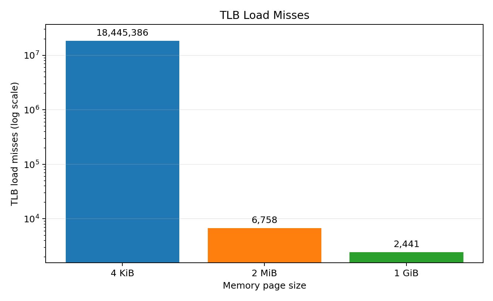
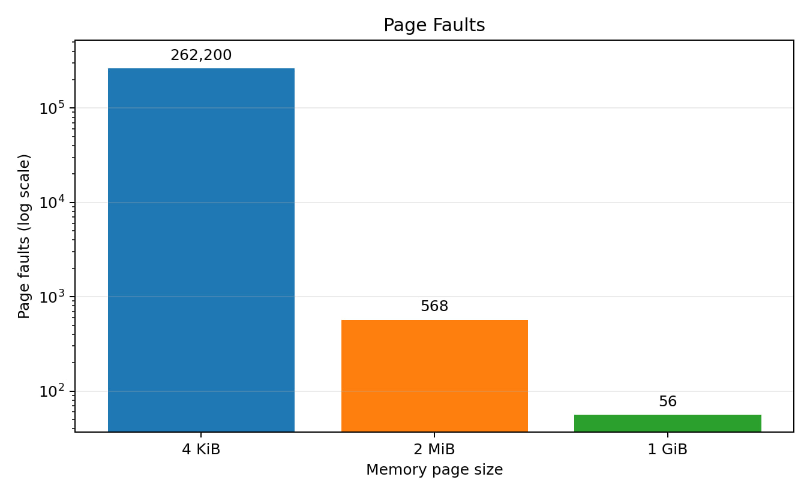
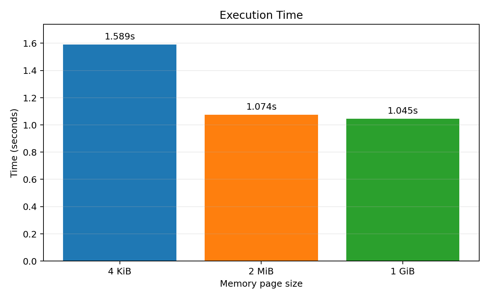
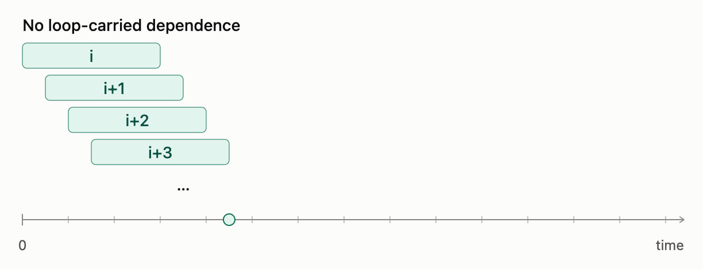
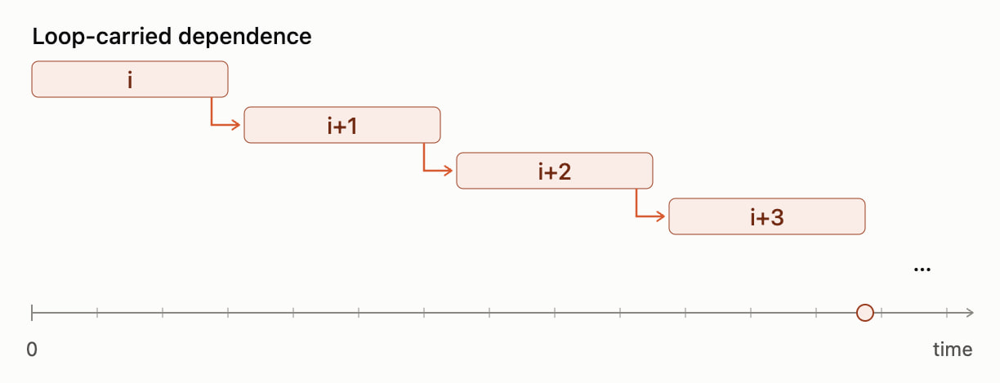

Parts [1](https://t.me/troubleperf/99), [2](https://t.me/troubleperf/104) and [3](https://t.me/troubleperf/116) (in Russian).

Before you drag anything into production, measure it properly.

Even if everyone around recommends the "tweak". Even if we're talking about huge pages.

Maybe I just wasn't paying attention, but I can't recall anyone ever talking people out of adopting them. The feedback is pretty much universally positive.

(I mean the real thing here, explicit huge pages, not THP.)

---

A very [recent article](https://andreybleme.com/2026-08-31/huge-pages-tlb-and-the-cost-of-memory-access/), "Huge pages, TLB, and the cost of memory access", is no exception.

It opens with a short primer and a benchmark showing that huge pages slashed dTLB misses from tens of millions down to a few thousand and made the benchmark a whopping 30% faster.

Now that is a serious claim.

Here is the benchmark from the article:

```c
int main(void) {
    char *memory = mmap(
        NULL,
        MEMORY_SIZE,
        PROT_READ | PROT_WRITE,
        MAP_PRIVATE | MAP_ANONYMOUS,
        -1,
        0
    );
    if (memory == MAP_FAILED) {
        perror("mmap");
        return 1;
    }

    // touch each page to ensure it is allocated, the first access to each page will trigger a page fault
    size_t page_count = MEMORY_SIZE / PAGE_SIZE;
    for (size_t i = 0; i < page_count; i++) {
        memory[i * PAGE_SIZE] = 1;
    }

    // visit each 4KiB page randomly, do that 100 times
    for (int j = 0; j < 100; j++) {
        for (size_t i = 0; i < page_count; i++) {
            size_t page = rand() % page_count;
            memory[page * PAGE_SIZE] += 1;
        }
    }

    printf("=== memory access completed successfully ===\n");

    munmap(memory, MEMORY_SIZE);

    return 0;
} // end of main
```

The huge-page version differed only in the extra `mmap` flags that enable them: `MAP_HUGETLB | MAP_HUGE_2MB`.

Counters and run time were measured with `perf` (output trimmed):

```bash
perf stat -r 5 \
  -e cycles,instructions,page-faults,dTLB-loads,dTLB-load-misses \
  ./benchmark
```

```text
    5,353,458,005  cycles
    2,869,417,305  instructions
          262,200  page-faults
      783,483,370  dTLB-loads
       18,445,386  dTLB-load-misses

    1.58942 seconds time elapsed
```

And the charts themselves:







You could settle for the nice numbers (the misses are gone, the time went down), remember the result and move on. Or you could take a closer look at the benchmark and get suspicious.

Especially since I once rolled out huge pages with exactly zero effect, so for me this is "personal".

---

Probably the most important questions we must keep asking ourselves are "what exactly do we want to measure" and "does the benchmark actually match that goal".

The benchmark boils down to two consecutive loops:

1. pre-touching the pages so they get populated (this is where the page faults happen)
2. walking the array at random addresses, to rule out any help from the hardware prefetchers and honestly measure the dTLB effect.

But if we want to measure step 2, why are we also counting step 1?

Let's put a pair of timestamps around the loop we care about:

```c
static double now_s(void) {
    struct timespec ts;
    clock_gettime(CLOCK_MONOTONIC, &ts);
    return ts.tv_sec + ts.tv_nsec * 1e-9;
}

int main(void) {
    ...
    double t0 = now_s();
    for (int j = 0; j < 100; j++) {
        for (size_t i = 0; i < page_count; i++) {
            ...
        }
    }
    double t1 = now_s();

    printf("Time in Loop: %.3f s\n", t1 - t0);
    ...
}
```

**Results**

| Page size | per iteration | vs 4K |
|-----------|--------------:|------:|
| 4K        | 39.9 ns       |       |
| 2M        | 37.5 ns       | 6.0%  |
| 1G        | 38.1 ns       | 4.5%  |

The 30% speedup collapsed to 4–6%. A bit disappointing, but more honest.

(By the way, the stock benchmark gave me +26%.)

Still, 5% isn't something you find lying on the road, right?

---

Perhaps. But let's keep being pedantic and figure out what those forty-odd nanoseconds are made of.

The loop body uses `rand()` to generate a random number:

```c
...
size_t page = rand() % page_count;
...
```

Who knows how that is implemented under the hood, so let's ask an AI for something cheaper, for example a few shifts:

```c
static inline uint64_t xs64(uint64_t *s) {
    uint64_t x = *s;
    x ^= x << 13; x ^= x >> 7; x ^= x << 17;
    return *s = x;
}

int main(void) {
    ...
    uint64_t seed = 42;  // must be nonzero
    ...
            size_t page = xs64(&seed) % page_count;
    ...
}
```

**Results**

(I'll drop 1G pages to keep it simple)

| Page size | per iteration | vs 4K   |
|-----------|--------------:|--------:|
| 4K        | 20.6 ns       |         |
| 2M        | 20.3 ns       | ~ 0.14% |

Even the 5% turned out to be fake.

But we saw the `perf stat` numbers, with TLB misses in the tens of millions!

Surely they can't be free? Or can they?

---

Zero overhead from 18 million TLB misses calls for an explanation.

Every operation has to cost time. The only question is how we count it.

Put simply, there is physical time (wall clock), the one we're used to measuring everything in (a connection RTT, for example, can be a very tangible 250 ms), and there is virtual time, which may or may not match the physical one.

To illustrate:

```console
# single-threaded compression
$ time xz -T1 -c data.txt > /dev/null

real 0m17.959s
user 0m17.918s
sys  0m0.020s

# compression with two threads
$ time xz -T2 -c data.txt > /dev/null

real 0m9.440s
user 0m16.934s
sys  0m0.075s
```

In both cases user+sys time adds up to roughly the same 17–18 s.

But the real time, or physical time in our terms, differs by a factor of two.

The same idea carries over to what happens inside the CPU.

To be as efficient as possible, the CPU finds independent instructions in the instruction stream and executes them, often in parallel, as soon as their operands become available.

This is called [Instruction Level Parallelism](https://en.wikipedia.org/wiki/Instruction-level_parallelism) (ILP).

So two kinds of time can exist at once:

- **physical**: execution gradually reaching a particular instruction
- **virtual**: the CPU running ahead and executing everything it can get its hands on.

The example from Wikipedia:

```text
e = a + b
f = c + d
m = e * f
```

`e` and `f` don't depend on each other and can be computed in parallel, provided their operands are available, of course.

`m`, on the other hand, depends on both `e` and `f`, so it has to wait for their values.

Now let's look at our hot loop from this angle:

```c
for (size_t i = 0; i < page_count; i++) {
    size_t page = xs64(&seed) % page_count;
    memory[page * PAGE_SIZE] += 1;
}
```

To increment an array element in the current iteration, we need to:

1. compute the index `page` (fast)
2. load the value from memory at index `page` (slow)
3. increment the value (fast)

Step three depends on step two, and step two on step one. This is a dependence within an iteration, a [loop-independent dependence](https://en.wikipedia.org/wiki/Loop_dependence_analysis).

But there is no dependence between iterations through the loaded value, i.e. no loop-carried dependence.

To compute `page` for iteration `i+1`, the CPU doesn't have to wait for the load from iteration `i`. The same goes for `i+2` and so on.

In effect, the CPU can run ahead and fire off as many loads and arithmetic operations as its hardware limits allow.

As a result, many operations overlap and hide their latency in physical time, even though each of them on its own costs a very real number of cycles:



Instruction-level parallelism is great for performance, but not for the goal of our benchmark. Here ILP can mislead us into the wrong conclusions.

So to measure the effect of huge pages more honestly, we'll have to add dependencies between loop iterations.

This is called [pointer chasing](https://en.algorithmica.org/hpc/cpu-cache/latency/):



*...to be continued...*
